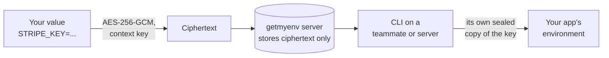

<div align="center">

<a href="https://getmyenv.com"></a>

# getmyenv

**Keep using environment variables. Stop managing them as files.**

Encrypted environment variables for any app. No SDK, no code changes.<br>
Values are encrypted on your machine. The server stores ciphertext only.

[](https://www.npmjs.com/package/getmyenv)
[](https://github.com/yobotn/getmyenv-cli/actions/workflows/ci.yml)
[](LICENSE)
[](https://nodejs.org)

[Website](https://getmyenv.com) · [Docs](https://getmyenv.com/docs) · [Security model](https://getmyenv.com/docs/security) · [Changelog](https://getmyenv.com/changelog)

</div>

```bash
cd your-project
npx getmyenv                       # set up this folder, no account needed
npx getmyenv import                # encrypt your .env and upload it
npx getmyenv run -- npm run dev    # start your app with the values
```

That is the whole setup. Your app still reads `process.env`, `os.environ` or `ENV`. It just stops depending on a `.env` file sitting on disk.

<p align="center">
  
</p>

## Why

`.env` files work until they don't. One copy lives on your laptop, another in a chat thread, an older one on the server, and nobody is sure which is current. A new teammate asks for "the env". An AI agent in your editor can read the file whenever it likes.

getmyenv keeps the part that works, environment variables, and removes the file:

- **One place for every value.** Each project has contexts: Development, Staging, Production, Customer Acme. Values are set once, per context.
- **Encrypted before upload.** The CLI or your browser encrypts each value. We store ciphertext and never see your Vault password.
- **Injected at start.** `npx getmyenv run -- <command>` decrypts the values for one context and starts your process with them. No .env file is written.
- **Any language.** The CLI needs Node 24 or newer where the app starts, also in a Python, Ruby or PHP container. Your app needs nothing.

## What you get

| | |
| --- | --- |
| **Contexts** | New projects start with Development (open) and Production (Read-only). Add as many as you need: `npx getmyenv context create "Customer Acme"`. |
| **Read-only contexts** | Production values that the CLI can read but never change. Only the owner sets Read-only values, in the dashboard. |
| **Servers** | A server token reads one Read-only context. New machines can wait for your approval, or become trusted machines. |
| **Teams** | Invite people per context. Each member gets their own sealed copy of each context key they can read. |
| **Explain before run** | `npx getmyenv run --explain` lists every name and where it comes from. Never values. |
| **Missing values** | `npx getmyenv set --missing` asks for every value not set yet, with hidden input. |
| **Hosting platforms** | `npx getmyenv push vercel` or `push netlify` copies a context with your own platform token. Values are decrypted on your machine. |
| **Backups** | `npx getmyenv backup` writes an encrypted file you keep. `restore` brings it back. |
| **Guest projects** | Start without an account. Claim the project later to keep it. |

<p align="center">
  
</p>

## How the encryption works



- Your account has a key pair. The private key is encrypted with your Vault password (Argon2id, AES-256-GCM). The server keeps that encrypted blob and the public key.
- Each context has its own key. It is sealed to the public key of each reader: you, each member you shared it with, and each server token.
- Each value is encrypted with AES-256-GCM under its context key, bound to its variable name.
- We cannot recover your Vault password. Your recovery code lets you set a new one and keeps every value.

All of this runs in [`packages/crypto`](packages/crypto), in this repository. Read it, run the tests, and compare it with what ships on npm. The full model, including what the service does and does not protect, is in [SECURITY.md](SECURITY.md) and at [getmyenv.com/docs/security](https://getmyenv.com/docs/security).

## For AI agents

Coding agents need to know which variables a project uses. They do not need the values. `npx getmyenv mcp` starts a local MCP server that gives them names and status only, never values.

```json
{ "mcpServers": { "getmyenv": { "command": "npx", "args": ["-y", "getmyenv", "mcp"] } } }
```

Tools: `status`, `list_contexts`, `declare_variables`, `create_guest_project`, `create_context`, `explain_run`, `ask_human_for_values`. When a value is needed, the agent gives you a command, and you type each value in a hidden prompt in your own terminal.

## Commands

| Command | What it does |
| --- | --- |
| `npx getmyenv` | Set up this folder: start as a guest or sign in, import your `.env`, set missing values |
| `run [context] -- <cmd>` | Run a command with a context's variables in its environment |
| `import` | Encrypt a `.env` file and upload it |
| `set` / `unset` | Set or remove values. `set KEY` prompts with hidden input |
| `ls` / `status` | Variable names by context with status, never values |
| `context` | List, create or pick contexts |
| `export` | Write a context to a plaintext `.env`, for tools that need one |
| `push vercel` / `push netlify` | Copy a context to your hosting platform |
| `backup` / `restore` | Encrypted backups of your open contexts |
| `guest` / `claim` | Start without an account, claim it later |
| `lock` | Forget every unlocked context key on this machine |
| `mcp` | Local MCP server for AI agents |

Every command and flag: [getmyenv.com/docs](https://getmyenv.com/docs).

## What is in this repository

| Folder | npm package | What it does |
| --- | --- | --- |
| [`packages/cli`](packages/cli) | [`getmyenv`](https://www.npmjs.com/package/getmyenv) | The CLI and its MCP server |
| [`packages/crypto`](packages/crypto) | [`@getmyenv/crypto`](https://www.npmjs.com/package/@getmyenv/crypto) | Key derivation, key sealing and value encryption |
| [`packages/shared`](packages/shared) | [`@getmyenv/shared`](https://www.npmjs.com/package/@getmyenv/shared) | Commands, flags and limits shared by the CLI and the site |

Build and test it yourself. Needs Node 24 or newer and pnpm (`corepack enable`).

```bash
pnpm install
pnpm check    # build, unit tests, and a smoke test of the packed CLI
```

## How this repository works

This is a read-only copy. The CLI is developed together with the getmyenv service in a private repository, and every change to these packages is copied here automatically, after a secret scan and a full build and test.

Issues and ideas are welcome. For a pull request, open an issue first: accepted changes are applied in the main repository and then appear here.

Found a security problem? Please do not open an issue. See [SECURITY.md](SECURITY.md).

## License

[MIT](LICENSE). The hosted service runs at [getmyenv.com](https://getmyenv.com). Accounts created during the pilot stay free.

<div align="center">
<br>
<a href="https://getmyenv.com"><b>getmyenv.com</b></a>
</div>
