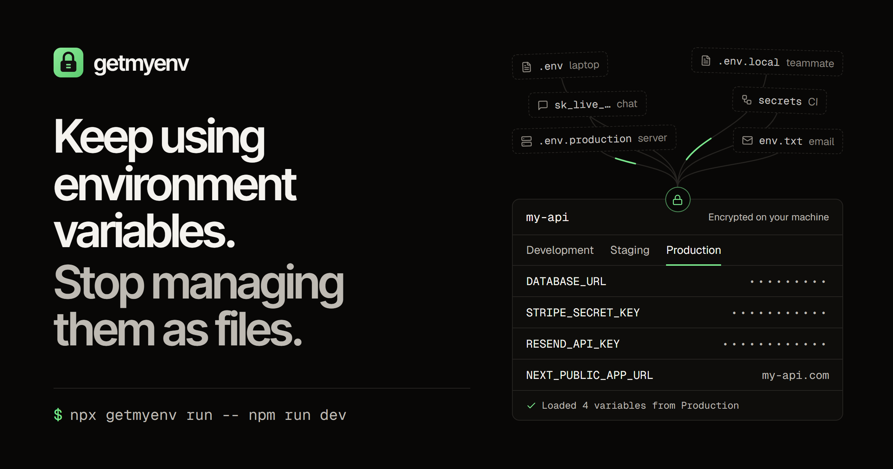

# getmyenv

<a href="https://getmyenv.com"></a>

Keep using environment variables. Stop managing them as files.

[getmyenv](https://getmyenv.com) is an encrypted store for environment variables and secrets. Use it from the dashboard or with `npx getmyenv`. We store ciphertext only.

```bash
cd your-project
npx getmyenv                          # Start without an account, or Sign in
npx getmyenv import                   # encrypt and upload your .env
npx getmyenv run -- npm run dev       # start with the default context
npx getmyenv run staging -- npm start # or pick one
```

- Run getmyenv where your app starts: your machine, the server, the CI job, or the container's start command. It needs Node 24 or newer there. run is the default. If getmyenv can't run where the app starts, export writes a plaintext .env instead.
- run fetches the values from getmyenv each time it starts. If it can't reach the server, the command does not start. A running process keeps its values.

## Commands

- `getmyenv`: setup in a new folder, status in a linked one. Without a TTY in an unlinked folder it prints next steps and exits with code 1.
- `run [context] -- <cmd>`: resolve, validate, merge, spawn. A missing value stops the run and prints its name (`--allow-missing` to run anyway). Context values for names that change how programs start, like `NODE_OPTIONS`, `PATH`, `LD_PRELOAD`, `DYLD_*`, `GIT_*`, `NPM_CONFIG_*`, `HTTPS_PROXY` or `BASH_ENV`, stop the run (`--allow-unsafe-env` to run anyway). The list is best effort. `GETMYENV_*` names from a context are never passed, and `set` and `import` refuse them. getmyenv values replace the parent env and replaced names are printed (`--keep-existing` to keep parent values). `--explain` lists names and origins, never values.
- `status`: project, token, contexts and the run command.
- `context list | create "<name>" [--from <slug>] [--use] | use <slug>`
- `set KEY[=VALUE]... [--expires <date|never>]`, `set KEY --stdin`, `set --missing` (asks, hidden, for every name with no value), `unset KEY... [--all]`, `ls`. Names are uppercase letters, numbers and underscores, like `API_KEY`. `set KEY=` does not clear a value. Use `unset`.
- `import [file] [--prune] [--dry-run] [--yes]`: `.env.<slug>` goes to that context.
- `export [-o file | --stdout] [--yes]`: for tools that need a file. The file is added to `.gitignore` and gets owner-only permissions on macOS and Linux.
- `guest [--name <name>]`: a project without an account. It stays active while the CLI uses it. After 30 days without use, or 180 days after creation, values can't change. For 30 more days, `run` still works and it can still be claimed.
- `claim`: claim a guest project. Reads `.getmyenv/claim.json`, or asks for the claim code and guest passphrase that `guest` printed once at a terminal.
- `backup [-o file]`: encrypted backup of open contexts (default `<project>.getmyenv-backup`). It opens with the Vault password or the recovery code in effect when it was made.
- `restore <file> [--dry-run] [--yes]`: restore a backup into this folder's project. Values go into open contexts with the same slug and replace values with the same name. Read-only and missing contexts are skipped.
- `start`: same as bare `getmyenv`. `start --template <id or link>` adds a template's variable names and asks for each value.
- `mcp`: a local MCP server on stdio for AI agents. See [AI agents (MCP)](#ai-agents-mcp).
- `lock`: forget every unlocked context key on this machine. `unlink [--yes] [--local]` (`--local` removes the local files without revoking the token), `help [command]`

`run`, `set`, `unset`, `ls`, `import` and `export` take `-c, --context <slug>`. The default is the server token's context, then `context` in `.getmyenv/project.json`, then `development`. Every command takes `--api-url <url>`.

Prompts and status lines go to stderr, so `export --stdout > .env` stays clean.

Commit `.getmyenv/project.json` and `.getmyenv/template.json`. `token.json` and `claim.json` stay local and are gitignored. `template.json` lists the variable names, never values. In a fresh clone, `npx getmyenv` can start a new project from it and asks for each value.

What the CLI writes. Not every folder has all four:

```text
my-app/
  .getmyenv/
    project.json   committed. Project id, name and the folder's default context. Written by setup, guest or sign-in.
    template.json  committed. Variable names, never values. Written once the project has a variable name.
    token.json     gitignored. The folder token. Written by sign-in or guest. Not used with GETMYENV_TOKEN.
    claim.json     gitignored, guest only. Claim code and guest passphrase. Keep it private. Written by guest. Deleted by claim.
```

<!-- cli:help -->
Output of `npx getmyenv --help` (1.1.1):

```text
Usage: getmyenv [options] [command]

Keep using environment variables. Stop managing them as files.

Options:
  -V, --version               Print the version
  --api-url <url>             API base URL
  -h, --help                  Show help

Commands:
  start [options]             Set up this folder (same as bare npx getmyenv).
                              Status when already linked.
  run [options] [context]     Run a command with a context's variables in its
                              environment
  status [options]            Show project, token, contexts and the run command
  context                     List, create or pick contexts
  set [options] [pairs...]    Set values: set KEY=VALUE, set KEY to be prompted,
                              or set --missing
  unset [options] <names...>  Remove values from a context
  ls [options]                Variable names by context with status (never
                              values)
  import [options] [file]     Encrypt a .env file and upload it (.env.<slug>
                              goes to that context)
  export [options]            Write a context to a plaintext .env file, for
                              tools that need one
  push [options] <provider>   Copy a context to Vercel or Netlify with your
                              platform token (VERCEL_TOKEN, NETLIFY_AUTH_TOKEN)
  guest [options]             Create a guest project without an account. It
                              stays active while you use it, up to 180 days.
                              Claim it to keep it.
  claim [options]             Claim a guest project (reads .getmyenv/claim.json,
                              or asks for the claim code)
  backup [options]            Write an encrypted backup of open contexts
  restore [options] <file>    Restore a backup into this folder's project (open
                              contexts with the same slug)
  lock [options]              Forget every unlocked context key on this machine
                              (OS keychain)
  unlink [options]            Revoke this folder's token and remove local
                              .getmyenv files
  mcp [options]               Start a local MCP server on stdio for AI agents.
                              Names and status only, never values
  help [command]              Show help for a command (same as <command> --help)

Environment:
  GETMYENV_TOKEN          Token for CI and servers (instead of .getmyenv/token.json). A server token holds its context key.
  GETMYENV_API_URL        API base URL (https, or http://localhost)
  GETMYENV_CONFIG_DIR     Machine identity and cache dir (default ~/.config/getmyenv)
  GETMYENV_SKIP_UPDATE    Set to 1 to skip the update notice
  GETMYENV_KEYCHAIN       Set to 0 to always ask for the Vault password
  GETMYENV_MACHINE_LABEL  Name shown for this machine in access requests
  GETMYENV_PUSH_API_URL   Vercel or Netlify API base URL, for tests (https, or http://localhost)
```
<!-- /cli:help -->

## Vault password

One Vault password per account unlocks your private key on your device. Each context has its own key, and each reader gets their own sealed copy. Forgot the Vault password? Your recovery code sets a new one in the dashboard. For open contexts, after you enter the Vault password in a terminal, the unlocked context keys stay in your OS keychain (macOS Keychain, Windows Credential Manager, Linux Secret Service) for 8 hours. The password is never stored.

- `npx getmyenv lock` removes every entry. `unlink` removes this project's.
- Server tokens hold their context key and never ask.
- Guest projects unlock with the passphrase in `.getmyenv/claim.json` and never ask.
- `GETMYENV_KEYCHAIN=0` always asks.

## CI and servers

Create a server token for one context in Project settings, Tokens. It holds that context's key.

```bash
export GETMYENV_TOKEN=...   # server token from the dashboard
npx getmyenv run -- node server.js
```

Windows PowerShell:

```powershell
$env:GETMYENV_TOKEN="..."
npx getmyenv run -- node server.js
```

Check it works: `npx getmyenv run --explain` lists each name and where its value comes from. Never values.

Server tokens are read-only. `set` needs the folder token from browser sign-in, or a guest project. `printf %s "$VALUE" | npx getmyenv set API_KEY --stdin` keeps the value out of argv.

- `GETMYENV_TOKEN`: a server token from Project settings, Tokens.
- `GETMYENV_CONFIG_DIR`: machine key and cache (default `~/.config/getmyenv`). Use a persistent volume in containers.
- `GETMYENV_API_URL`: API origin. https only, http for localhost.
- `GETMYENV_MACHINE_LABEL`: the machine name shown in approval requests.
- `GETMYENV_SKIP_UPDATE=1`: skip the update notice.
- `GETMYENV_KEYCHAIN=0`: never use the OS keychain.
- The update check and the keychain are skipped when `CI` is set (unless it is `false` or `0`).

## Open and Read-only

- Open contexts: the CLI can read and write. Browser sign-in gives the folder a token in `.getmyenv/token.json`.
- Read-only contexts: the CLI can read and export, never write. Only the owner sets Read-only values, in the dashboard. Use a server token from Project settings, Tokens (one context, IP allowlist) with `GETMYENV_TOKEN`. Each server token has a new machines rule: ask you on Requests (default), trust machines from its allowed IPs on first read (each entry /24 or narrower, IPv6 /64), or block them. Trusted machines read without asking. `status` shows the rule.

## AI agents (MCP)

`npx getmyenv mcp` runs a local MCP server (protocol 2025-06-18) on stdin and stdout. Add it to your MCP client:

```json
{"mcpServers":{"getmyenv":{"command":"npx","args":["-y","getmyenv","mcp"]}}}
```

Secret values never enter the agent's context. No tool reads, returns or accepts a value, a token, a claim code or ciphertext. Every tool takes an optional `cwd`, the project folder (default: the folder the server started in).

- `status`: project, token kind, contexts, and the status of each variable name in each context.
- `list_contexts`: contexts with slug, name and protection.
- `declare_variables`: `{ names, context? }`. Adds names with no values, like `set KEY=`. An entry with `=` is refused.
- `create_guest_project`: `{ name? }`. A guest project without an account, like `guest --name`. Returns the project name, when it expires and how the human claims it.
- `create_context`: `{ name, from? }`. Like `context create`.
- `explain_run`: `{ context? }`. Like `run --explain`: names and where each value comes from.
- `ask_human_for_values`: `{ context? }`. The names with no value and the command the human runs in their own terminal, `npx getmyenv set --missing`. Each value goes into a hidden prompt.

When the folder is not linked or the token ended, a tool returns an error with the same next steps as the CLI. The server never prompts.

## Chaining

```bash
op run -- npx getmyenv run staging -- npm start
```

License: MIT (see [LICENSE](./LICENSE)). The hosted service at getmyenv.com has its own Terms.

See https://getmyenv.com/docs
